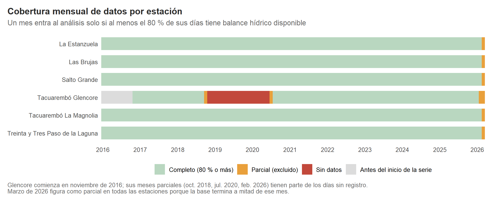
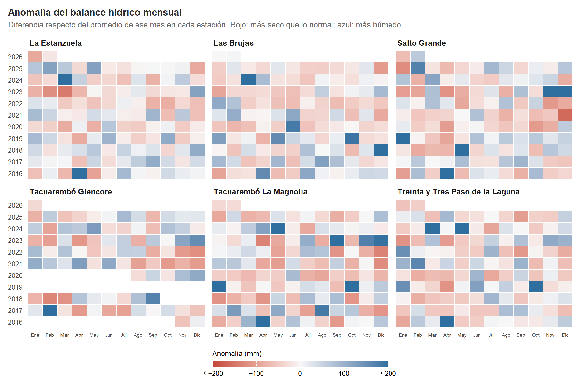
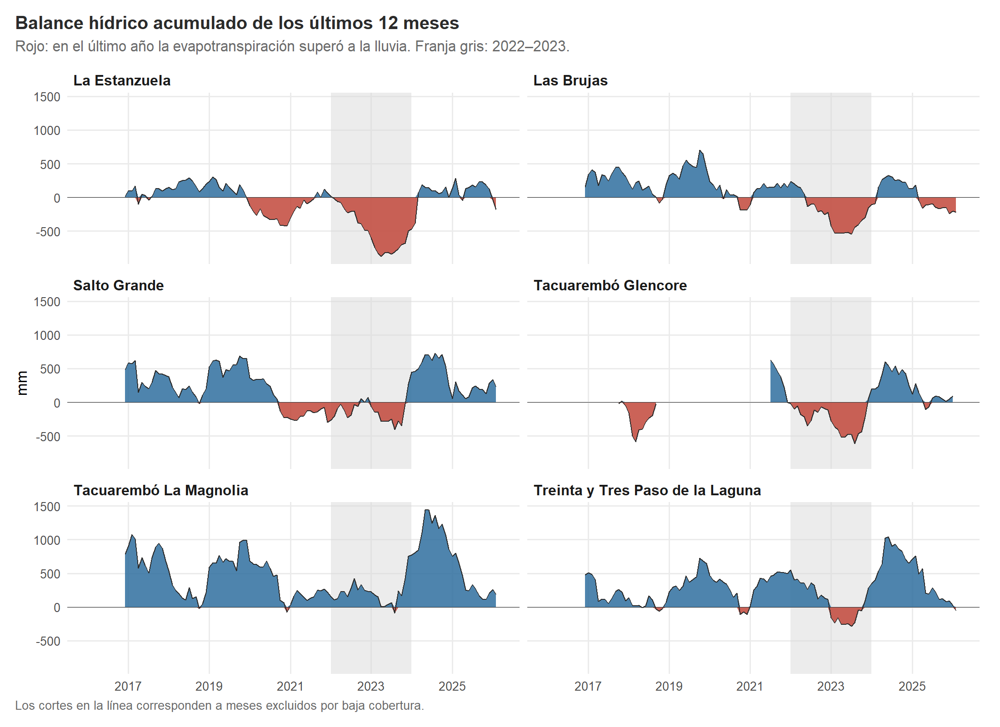
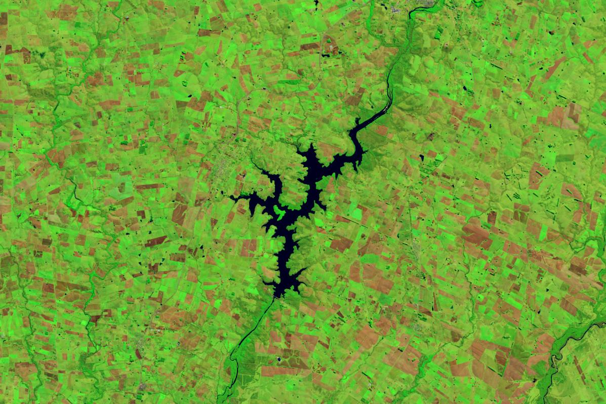
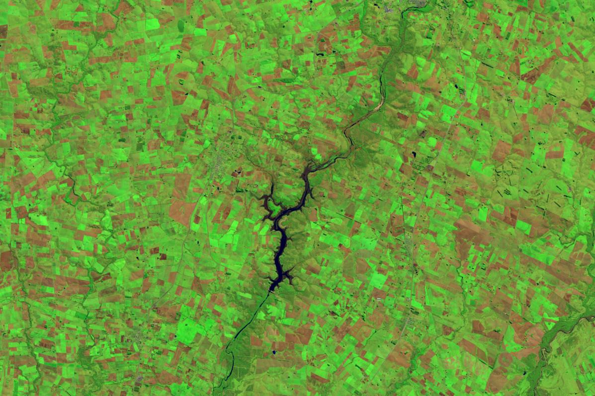
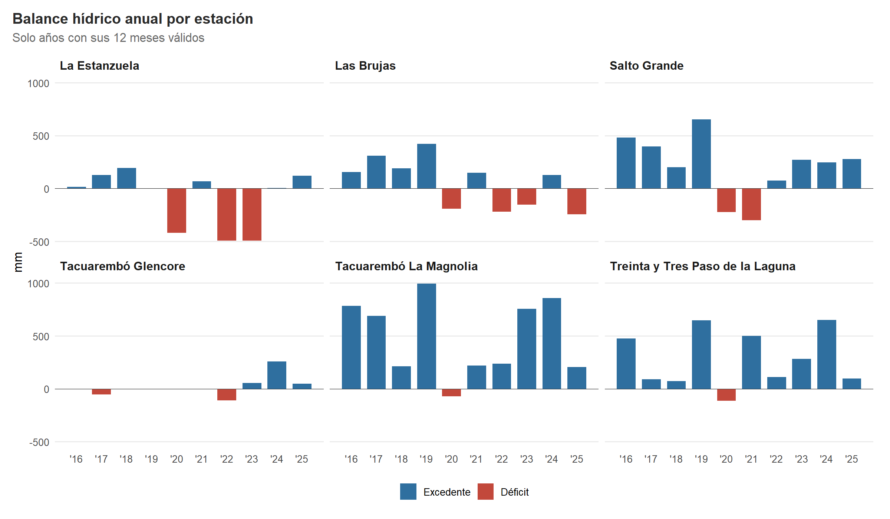
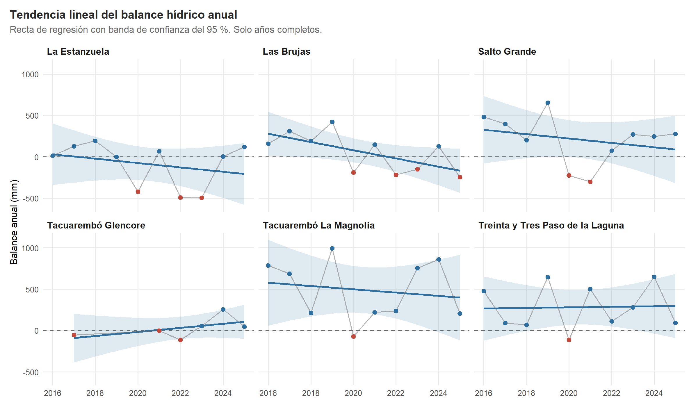

```{r}
#| label: setup
# El informe se renderiza desde report/, por eso los caminos comienzan con "../".
# No recalcula el análisis: lee las tablas y figuras que generan los scripts.
if (dir.exists("../r_packages")) .libPaths(c(normalizePath("../r_packages"), .libPaths()))
suppressPackageStartupMessages({
  library(dplyr)
  library(readr)
  library(knitr)
})

leer <- function(nombre) read_csv(file.path("../outputs/tables", nombre), show_col_types = FALSE)
# Formato numerico en espanol: separador de miles ".", decimales "," y signo
# menos tipografico. formatC trabaja elemento por elemento, sin rellenar con espacios.
fmt <- function(x, d = 0) {
  texto <- formatC(round(x, d), format = "f", digits = d, big.mark = ".", decimal.mark = ",")
  texto <- sub("^-", "−", texto)
  texto[is.na(x)] <- "–"
  texto
}

# Los catalogos traen los departamentos en mayusculas y sin tildes.
nombre_departamento <- function(x) {
  x <- tools::toTitleCase(tolower(x))
  recode(x, "Tacuarembo" = "Tacuarembó", "Treinta y Tres" = "Treinta y Tres")
}

# kable con alineacion explicita: texto a la izquierda, numeros a la derecha.
tabla <- function(datos, alineacion, ...) kable(datos, align = alineacion, ...)

calidad <- leer("control_calidad_por_estacion.csv")
cobertura <- leer("cobertura_por_estacion.csv")
anual <- leer("balance_anual.csv")
sequia <- leer("indicadores_sequia.csv")
sql_secos <- leer("sql_meses_mas_secos.csv")
sql_sequia <- leer("sql_sequia_2022_2023.csv")
tendencias <- leer("tendencias_lm.csv")
diario <- read_csv("../data/processed/inia_diario_limpio.csv", show_col_types = FALSE)

glencore <- calidad %>% filter(grepl("Glencore", estacion))
estanzuela_2022_23 <- sql_sequia %>% filter(estacion == "La Estanzuela")
magnolia_2022_23 <- sql_sequia %>% filter(estacion == "Tacuarembó La Magnolia")
peor <- sequia %>% slice(1)

# Comparacion de las dos estaciones de Tacuarembo en los anios completos de ambas.
tacuarembo <- anual %>%
  filter(anio_completo, grepl("Glencore|Magnolia", estacion)) %>%
  mutate(est = if_else(grepl("Glencore", estacion), "glencore", "magnolia")) %>%
  select(anio, est, precipitacion_anual, eto_anual) %>%
  tidyr::pivot_wider(names_from = est, values_from = c(precipitacion_anual, eto_anual)) %>%
  filter(!is.na(precipitacion_anual_glencore), !is.na(precipitacion_anual_magnolia)) %>%
  mutate(menos_lluvia_pct = 100 * (1 - precipitacion_anual_glencore / precipitacion_anual_magnolia))
glencore_2017 <- tacuarembo %>% filter(anio == 2017)

# --- Bloques de diseño generados con los datos ------------------------------
meses_nombre <- c("enero", "febrero", "marzo", "abril", "mayo", "junio", "julio",
                  "agosto", "septiembre", "octubre", "noviembre", "diciembre")
con_signo <- function(x) paste0(if_else(x > 0, "+", ""), fmt(x))

# Nombre corto y posición aproximada de cada estación en el mapa (coordenadas
# del dibujo, no geográficas). dx/dy ubican la etiqueta respecto del círculo.
estaciones_mapa <- tibble::tribble(
  ~estacion,                          ~corto,              ~cx,   ~cy,   ~dx, ~dy, ~ancla,
  "La Estanzuela",                    "La Estanzuela",      99.7, 439.1,  14,  34, "start",
  "Las Brujas",                       "Las Brujas",        212.7, 471.9,  22,  14, "start",
  "Tacuarembó Glencore",              "Glencore",          220.2, 211.8, -14,  26, "end",
  "Salto Grande",                     "Salto Grande",       83.0, 134.4,  26,  -4, "start",
  "Treinta y Tres Paso de la Laguna", "Paso de la Laguna", 394.4, 332.9, -28,  34, "end",
  "Tacuarembó La Magnolia",           "La Magnolia",       256.2, 177.1,  40, -10, "start"
)
balance_mapa <- sql_sequia %>%
  arrange(balance_2022_2023_mm) %>%
  inner_join(estaciones_mapa, by = "estacion") %>%
  mutate(
    valor = balance_2022_2023_mm,
    radio = 6 + 24 * sqrt(abs(valor) / max(abs(valor))),
    clase = if_else(valor < 0, "neg", "pos")
  )
```

```{r}
#| label: cifras
#| output: asis
# Resumen inicial con los valores de las tablas 2, 3 y 5.
barras <- balance_mapa %>%
  mutate(li = sprintf(
    '<li data-valor="%s"><span class="b-nombre">%s<small>%s</small></span><span class="b-pista"><span class="b-barra"></span></span><span class="b-num%s">%s</span></li>',
    valor, corto, nombre_departamento(departamento), if_else(valor < 0, " neg", ""), con_signo(valor)
  )) %>%
  pull(li)
n_con_tendencia <- sum(tendencias$interpretacion != "sin evidencia de tendencia lineal")
mes_peor <- as.Date(peor$mes_del_minimo)

cat(
  '<section class="cifras" aria-labelledby="cifras-titulo">',
  '<div class="cifras-cab"><h2 id="cifras-titulo">Resultados en cifras</h2><p>Valores de las tablas 2, 3 y 5</p></div>',
  '<div class="cifras-grid">',
  '<div class="cifra cifra-principal">',
  '<h3>Balance acumulado 2022-2023 por estación</h3>',
  '<p>Precipitación menos evapotranspiración, suma de los 24 meses (mm).</p>',
  '<ul class="barras">', barras, '</ul>',
  '<p class="barras-leyenda"><span class="ley-def">déficit</span><span>excedente</span></p>',
  '</div>',
  '<div class="cifra"><h3>Peor acumulado de 12 meses</h3>',
  sprintf('<div class="cifra-valor es-deficit">%s<small>mm</small></div>', fmt(peor$balance_acumulado_minimo)),
  sprintf('<p>%s, 12 meses que terminan en %s de %s.</p>', peor$estacion,
          meses_nombre[as.integer(format(mes_peor, "%m"))], format(mes_peor, "%Y")),
  '</div>',
  '<div class="cifra"><h3>Tendencia lineal 2016-2025</h3>',
  sprintf('<div class="cifra-valor">%d de %d<small>estaciones</small></div>', n_con_tendencia, nrow(tendencias)),
  sprintf('<p>%s el IC 95 %% de la pendiente excluye el cero.</p>',
          if (n_con_tendencia == 0) "En ninguna estación" else "En esas estaciones"),
  '</div>',
  '<div class="cifra"><h3>Base analizada</h3>',
  sprintf('<div class="cifra-valor">%s<small>registros diarios</small></div>', fmt(nrow(diario))),
  sprintf('<p>%d estaciones agroclimáticas de INIA, de %s a %s.</p>',
          n_distinct(diario$estacion), format(min(diario$fecha)), format(max(diario$fecha))),
  '</div>',
  '</div>',
  '</section>',
  sep = "\n"
)
```

# Introducción y pregunta

Uruguay atravesó entre 2022 y 2023 una de las sequías más severas de las últimas décadas. Para el sector agropecuario, lo importante no es solo cuánto llueve, sino cuánta agua queda disponible después de la que demanda la atmósfera. Por eso usamos el **balance hídrico climático**:

$$
\text{balance} = \text{precipitación} - \text{evapotranspiración de referencia (Penman)}
$$

**Pregunta:** ¿cómo se comportó el balance hídrico en las estaciones agroclimáticas de INIA entre 2016 y 2025, qué tan intensa fue la sequía de 2022–2023 y afectó por igual al sur y al norte del país?

::: {.callout-tip appearance="simple" icon=false}
- **No afectó a todos por igual.** En 2022–2023 el sur se quedó sin agua: en La Estanzuela (Colonia) la evaporación superó a la lluvia por **`r fmt(abs(estanzuela_2022_23$balance_2022_2023_mm))` mm**. En el norte, en cambio, La Magnolia (Tacuarembó) tuvo **`r fmt(magnolia_2022_23$balance_2022_2023_mm)` mm de agua a favor**.
- **La sequía fue larga, no puntual:** lo que la hizo grave fue que faltó agua muchos meses seguidos.
- **No es una tendencia:** en estos 10 años el balance no empeora de forma sostenida. La sequía fue un episodio.
:::

# Datos

- `INIA.csv`: `r fmt(nrow(diario))` registros diarios de `r n_distinct(diario$estacion)` estaciones, entre `r format(min(diario$fecha))` y `r format(max(diario$fecha))`.
- `EstacionAgr.csv` y `Departamentos.csv`: catálogos que asignan cada estación a su departamento.
- Variables utilizadas: `PrecipAcum` (precipitación diaria, mm) y `EvapotranspPenman` (evapotranspiración Penman-Monteith ajustada a Uruguay, mm). Como apoyo para validar se usan `TempAireMedia`, `TempAireMax`, `TempAireMin`, `HRMed` y `Llovio`.

Los datos originales están en `data/raw/` y nunca se modifican. Todo lo derivado se genera en `data/processed/` y en `outputs/`.

```{=html}
<figure class="pipeline" aria-label="Esquema del pipeline de datos">
<ol class="pipeline-pasos">
<li class="paso-almacen"><span class="paso-lugar">data/raw/</span><span class="paso-nodo"></span><div class="paso-cuerpo"><h4>Datos originales</h4><p>INIA.csv, EstacionAgr.csv y Departamentos.csv. Solo lectura: nunca se modifican.</p></div></li>
<li class="paso-proceso"><span class="paso-lugar">verificación</span><span class="paso-nodo"></span><div class="paso-cuerpo"><h4>Validación de estructura y join <span class="paso-alto">detiene si falla</span></h4><p>Columnas requeridas, estaciones presentes en el catálogo, fechas válidas y ningún registro sin departamento.</p></div></li>
<li class="paso-proceso"><span class="paso-lugar">01_preparar_datos.R</span><span class="paso-nodo"></span><div class="paso-cuerpo"><h4>Limpieza y control de calidad</h4><p>Normalización NFC, corrección de la errata, ceros y valores fuera de rango a NA, control por estación con map_dfr y regla de cobertura del 80 %.</p></div></li>
<li class="paso-almacen"><span class="paso-lugar">data/processed/</span><span class="paso-nodo"></span><div class="paso-cuerpo"><h4>Base procesada</h4><p>Base diaria limpia y base relacional inia.sqlite con los datos mensuales y los dos catálogos.</p></div></li>
<li class="paso-proceso"><span class="paso-lugar">análisis</span><span class="paso-nodo"></span><div class="paso-cuerpo"><h4>Indicadores y modelos</h4><p>Agregación mensual con group_nest() + map(), anomalías, acumulado móvil de 12 meses, consultas SQL con JOIN y GROUP BY y regresión lineal por estación.</p></div></li>
<li class="paso-almacen"><span class="paso-lugar">outputs/</span><span class="paso-nodo"></span><div class="paso-cuerpo"><h4>Tablas, figuras e informe</h4><p>Los resultados se regeneran con los scripts y este informe Quarto los integra.</p></div></li>
</ol>
<figcaption class="pipeline-pie"><span><strong>Esquema del pipeline.</strong> Todo se reconstruye desde data/raw ejecutando <code>run_all.R</code>, sin pasos manuales.</span><span class="pipeline-leyenda"><span class="ley-almacen">datos</span><span class="ley-proceso">proceso</span></span></figcaption>
</figure>
```

# Preparación y calidad de los datos

## Decisiones de preparación

1. **Normalización de texto.** Los nombres de las estaciones venían con las tildes en forma Unicode *descompuesta* (letra + acento combinado). Se normalizaron a la forma compuesta (NFC) antes del *join*.
2. **Corrección de una errata.** En los archivos originales (datos y catálogo) el nombre de la estación está mal escrito: "Tacuare**mn**ó", con "mn" en lugar de "mb". Se usó ese nombre original para unir las tablas y después se lo corrigió. Desde ahí, en todo el informe aparece con el nombre correcto, **Tacuarembó Glencore**.
3. **Ceros como faltantes.** Hay `r sum(calidad$ceros_como_faltante)` días con temperatura media **y** humedad relativa iguales a 0 al mismo tiempo, `r glencore$ceros_como_faltante` de ellos en Glencore. Eso no es físicamente plausible: así codifica la fuente un dato faltante. Se reemplazaron por `NA`.
4. **Rangos físicos.** Humedad relativa fuera de 0–100 % (`r sum(calidad$hr_fuera_rango)` casos) y evapotranspiración negativa (`r sum(calidad$eto_negativa)` caso) se reemplazaron por `NA`. No se eliminan filas.
5. **Cobertura.** Un mes se usa solo si al menos el 80 % de sus días tiene balance disponible. Un año se compara solo si sus 12 meses son válidos. La regla excluye automáticamente 2026 (incompleto) y los períodos con huecos.

## Validaciones del pipeline

- **Estructura:** antes de procesar se verifica que existan las columnas necesarias en las tres tablas y que todas las estaciones de INIA estén en el catálogo. Si algo falla, el pipeline se detiene con un mensaje claro.
- **Join:** se comprueba que ninguna fecha quede inválida y ningún registro quede sin departamento. En la base SQL se repite el control con un `LEFT JOIN`.
- **Calidad por estación** (automatizada con `map_dfr`): fechas duplicadas, días ausentes, ceros como faltante, rangos, `Tmax < Tmin` y consistencia entre `Llovio` y la precipitación. Las fechas duplicadas y la precipitación negativa son errores fatales.

```{r}
#| label: tbl-calidad
#| tbl-cap: "Control de calidad por estación (generado por 01_preparar_datos.R)"
calidad %>%
  select(estacion, registros, dias_ausentes, fechas_duplicadas, ceros_como_faltante,
         hr_fuera_rango, tmax_menor_tmin, llovio_inconsistente) %>%
  left_join(cobertura %>% select(estacion, meses_excluidos), by = "estacion") %>%
  mutate(across(-estacion, fmt)) %>%
  tabla("lrrrrrrrr",
        col.names = c("Estación", "Registros", "Días ausentes", "Fechas duplicadas",
                      "Ceros como faltante", "HR fuera de rango", "Tmax < Tmin",
                      "Llovió inconsistente", "Meses excluidos"))
```

La estación **Glencore** concentra casi todos los problemas: empieza en noviembre de 2016, le faltan `r glencore$dias_ausentes` días (todo 2019, más de la mitad de 2020 y unos dos meses de 2018) y tiene `r glencore$ceros_como_faltante` días con ceros como faltante. Se conserva en la base, pero la regla de cobertura deja `r cobertura$meses_excluidos[grepl("Glencore", cobertura$estacion)]` de sus meses fuera del análisis.

La @fig-cobertura muestra esta regla aplicada mes a mes. El gris (antes de noviembre de 2016) indica que la serie de Glencore todavía no había comenzado. El rojo (2019–2020) indica que la estación existía pero no registró datos.

{#fig-cobertura}

# Análisis

## Transformaciones temporales

A partir de la base diaria limpia:

1. **Agregación mensual por estación**, automatizada con `group_nest()` + `map(resumir_mensual)`. La función usa `sumar_si_hay_datos()` para que un mes sin información quede como `NA` y no como 0, y completa con `complete()` los meses ausentes.
2. **Anomalía mensual:** el balance del mes menos el promedio de ese mismo mes en la estación. Así se compara cada mes contra lo "normal" de su época del año.
3. **Balance acumulado móvil de 12 meses** con `slider::slide_dbl()`. Solo se calcula si los 12 meses de la ventana son válidos.
4. **Variación respecto del mes anterior** con `lag()`.
5. **Agregación anual** de los años completos.

## Patrones mensuales y la sequía 2022–2023

La @fig-anomalias compara cada mes con lo normal para esa época del año en cada estación. La @fig-acumulado muestra el balance de los últimos 12 meses, que suaviza la variación mensual y deja ver los períodos secos prolongados.

{#fig-anomalias}

{#fig-acumulado}

El acumulado de 12 meses muestra dos períodos secos generalizados: el ciclo 2020–2021 y, con más fuerza, 2022–2023. El mínimo absoluto lo alcanzó **`r peor$estacion`**: `r fmt(peor$balance_acumulado_minimo)` mm en los 12 meses que terminan en `r format(peor$mes_del_minimo, "%m/%Y")`. Después, 2024 cerró con balance positivo en todas las estaciones, aunque en La Estanzuela apenas superó el equilibrio.

```{=html}
<figure class="comparador">
<div class="comp-lienzo">


<span class="comp-etq comp-etq-a">Junio 2022</span>
<span class="comp-etq comp-etq-b">13 de junio de 2023</span>
<span class="comp-linea" aria-hidden="true"></span>
<span class="comp-mango" aria-hidden="true">‹ ›</span>
<input type="range" min="0" max="100" value="50" step="0.1" aria-label="Deslizar para comparar junio de 2022 con junio de 2023">
</div>
<figcaption class="quarto-float-caption quarto-float-caption-bottom"><span class="cap-num">Satélite</span><span class="cap-texto">Embalse de Paso Severino (Florida) en junio de 2022 y en junio de 2023. Arrastrá la barra para comparar. Imágenes Landsat 9, NASA, dominio público.</span></figcaption>
</figure>
```

```{r}
#| label: tbl-sequia
#| tbl-cap: "Indicadores de sequía por estación"
sequia %>%
  transmute(
    Estación = estacion,
    Departamento = nombre_departamento(departamento),
    `Peor acumulado de 12 meses (mm)` = fmt(balance_acumulado_minimo),
    `Mes del peor acumulado` = format(mes_del_minimo, "%m/%Y"),
    `Meses con déficit (%)` = fmt(100 * meses_con_deficit_pct),
    `Anomalía 2022–23 (mm)` = fmt(anomalia_2022_2023)
  ) %>%
  tabla("llrcrr")
```

## Consulta relacional (SQL)

Los datos mensuales y los dos catálogos se guardan como tablas relacionadas en una base SQLite (`data/processed/inia.sqlite`). Las consultas de `sql/consultas.sql` cruzan las tres tablas con `JOIN` y resumen con `GROUP BY`.

```{r}
#| label: tbl-sql-sequia
#| tbl-cap: "Balance acumulado 2022–2023 por estación (consulta sequia_2022_2023)"
sql_sequia %>%
  mutate(departamento = nombre_departamento(departamento),
         balance_2022_2023_mm = fmt(balance_2022_2023_mm, 1)) %>%
  tabla("llrrr", col.names = c("Departamento", "Estación", "Meses válidos",
                               "Meses con déficit", "Balance 2022–23 (mm)"))
```

El contraste regional es claro: en 2022–2023 La Estanzuela (Colonia) acumuló un balance de `r fmt(estanzuela_2022_23$balance_2022_2023_mm)` mm, con `r estanzuela_2022_23$meses_con_deficit` de 24 meses en déficit. En el mismo período, La Magnolia (Tacuarembó) tuvo un excedente de `r fmt(magnolia_2022_23$balance_2022_2023_mm)` mm. **La sequía golpeó sobre todo al sur.**

```{r}
#| label: mapa
#| output: asis
# Mapa de Uruguay: los contornos de los departamentos son fijos (Natural Earth);
# el tamaño, el color y el valor de cada círculo salen de la Tabla 3.
departamentos_svg <- paste(readLines("estilo/mapa_departamentos.svg", encoding = "UTF-8"), collapse = "\n")
circulos <- balance_mapa %>%
  mutate(i = row_number() - 1, g = sprintf(
    '<g class="estacion %s" style="--i:%d"><circle class="onda" cx="%.1f" cy="%.1f" r="%.1f"/><circle class="burbuja" cx="%.1f" cy="%.1f" r="%.1f"/><circle class="punto" cx="%.1f" cy="%.1f" r="2.6"/><text x="%.1f" y="%.1f" text-anchor="%s"><tspan class="m-nombre">%s</tspan><tspan class="m-valor" x="%.1f" dy="15">%s mm</tspan></text></g>',
    clase, i, cx, cy, radio, cx, cy, radio, cx, cy, cx + dx, cy + dy, ancla, corto, cx + dx, con_signo(valor)
  )) %>%
  pull(g)

cat(
  '<figure class="mapa">',
  '<div class="mapa-lienzo"><svg class="mapa-svg" viewBox="0 0 520 520" role="img" aria-label="Mapa de Uruguay con el balance hídrico acumulado 2022-2023 de las seis estaciones">',
  departamentos_svg,
  '<g class="estaciones">', circulos, '</g>',
  '</svg></div>',
  '<figcaption class="mapa-texto">',
  '<h3>El mismo período, dos realidades</h3>',
  '<p>Balance hídrico acumulado entre enero de 2022 y diciembre de 2023. El área de cada círculo es proporcional a la magnitud del balance.</p>',
  '<p class="mapa-leyenda"><span class="ley-def">déficit</span><span class="ley-exc">excedente</span></p>',
  '<p class="mapa-nota">Valores de la Tabla 3. Ubicación aproximada de las estaciones dentro de su departamento.</p>',
  '</figcaption>',
  '</figure>',
  sep = "\n"
)
```

El norte no quedó al margen. Como muestra la @tbl-sequia, todas las estaciones alcanzaron su peor acumulado de 12 meses entre abril y agosto de 2023. Lo que cambia es la duración: en el sur el déficit venía acumulándose desde 2022, mientras que en Salto y Tacuarembó las lluvias de fines de 2023 lo revirtieron. Por eso el balance de los dos años es positivo o cercano a cero en el norte.

Además, las dos estaciones de Tacuarembó difieren mucho entre sí: en 2022–2023 Glencore tuvo un balance de `r fmt(sql_sequia$balance_2022_2023_mm[grepl("Glencore", sql_sequia$estacion)])` mm y La Magnolia de +`r fmt(magnolia_2022_23$balance_2022_2023_mm)` mm. La diferencia viene sobre todo de la lluvia: en todos los años completos de ambas estaciones, Glencore registró entre un `r fmt(min(tacuarembo$menos_lluvia_pct))` % y un `r fmt(max(tacuarembo$menos_lluvia_pct))` % menos de precipitación que La Magnolia. Puede deberse a la variabilidad local de la lluvia, a diferencias en la medición o a ambas. En cualquier caso, muestra que una sola estación no alcanza para caracterizar un departamento.

```{r}
#| label: tbl-sql-secos
#| tbl-cap: "Los 10 meses más secos (consulta meses_mas_secos)"
sql_secos %>%
  mutate(departamento = nombre_departamento(departamento),
         mes = format(as.Date(mes), "%m/%Y"),
         across(c(precipitacion_mm, eto_mm, balance_mm), ~ fmt(.x, 1))) %>%
  tabla("llcrrr", col.names = c("Departamento", "Estación", "Mes", "Precipitación (mm)",
                                "Evapotranspiración (mm)", "Balance (mm)"))
```

Los 10 meses más secos son todos de diciembre o enero, cuando la evapotranspiración es máxima. Además, no se concentran en 2022–2023 ni en el sur. La sequía no se explica por unos pocos meses extremos, sino por la **persistencia** de muchos meses consecutivos con déficit, y eso es justamente lo que muestra el acumulado de 12 meses.

## Balance anual y tendencia

En la escala anual (@fig-anual), 2020 fue el único año con déficit en todas las estaciones que tienen ese año completo. En el sur se suman 2022 y 2023, y en Las Brujas también 2025. En el norte y el este, en cambio, predominan los excedentes.

{#fig-anual}

Para saber si los déficits son parte de una tendencia o episodios puntuales, se ajustó una regresión lineal `balance_anual ~ anio` para cada estación. Se automatizó con `group_nest()` + `map()`, una versión tolerante a errores con `possibly()` y extracción de resultados con `broom`. La @fig-tendencias muestra cada recta con su banda de confianza, y la @tbl-tendencias resume las pendientes.

{#fig-tendencias}

```{r}
#| label: tbl-tendencias
#| tbl-cap: "Pendiente estimada del balance anual (mm/año) con intervalo de confianza del 95%"
tendencias %>%
  transmute(
    Estación = estacion,
    `Años` = anios_usados,
    `Pendiente (mm/año)` = fmt(pendiente_mm_por_anio, 1),
    `IC 95 % (mm/año)` = paste0(fmt(ic_inferior, 1), " a ", fmt(ic_superior, 1)),
    `Valor p` = fmt(valor_p, 3),
    Interpretación = interpretacion
  ) %>%
  tabla("lrrrrl")
```

En ninguna estación el intervalo de confianza excluye el cero. Con 10 años de datos, **no hay evidencia de una tendencia lineal** en el balance anual. Los déficits de 2020 y de 2022–2023 se ven como episodios, no como un deterioro sostenido. Las Brujas es el caso más cercano a una tendencia negativa (p ≈ `r fmt(tendencias$valor_p[tendencias$estacion == "Las Brujas"], 2)`), pero no alcanza a ser concluyente.

# Resultados principales

1. Entre 2016 y 2025 hubo dos períodos de déficit hídrico generalizado: 2020–2021 y 2022–2023. El segundo fue el más intenso.
2. La sequía 2022–2023 fue **regional**: severa y prolongada en el sur (Colonia y Canelones). En el norte (Salto y Tacuarembó) también hubo déficit a mediados de 2023, pero fue más corto y las lluvias de fines de ese año lo compensaron.
3. Los déficits mensuales más grandes ocurren en diciembre y enero. Sin embargo, la sequía se explica por la persistencia del déficit durante muchos meses, no por meses aislados extremos.
4. Con la serie disponible no se detecta una tendencia lineal del balance anual en ninguna estación.
5. Los datos de Glencore tienen problemas de calidad importantes. El pipeline los detecta y los excluye por una regla explícita.

# Limitaciones

- **Serie corta:** 10 años no alcanzan para hablar de tendencias climáticas. La regresión es descriptiva y tiene muy pocos puntos.
- **Balance simplificado:** no considera el almacenamiento de agua en el suelo, el escurrimiento ni las necesidades de un cultivo concreto. Además, la evapotranspiración es un valor calculado, no medido.
- **Representatividad:** cada estación es un punto; no representa a todo su departamento.
- **Calidad de origen:** según los metadatos, la heliofanía de Las Brujas se estima con un modelo desde diciembre de 2020. Además, `AmplitudTermica` no coincide con `TempAireMax − TempAireMin` en miles de registros. Ninguna de esas variables entra en el balance, pero muestran que las variables derivadas de la fuente deben revisarse.
- **Glencore:** la serie es incompleta y en 2017 su evapotranspiración anual (`r fmt(glencore_2017$eto_anual_glencore)` mm) se aparta mucho de la de La Magnolia (`r fmt(glencore_2017$eto_anual_magnolia)` mm), en el mismo departamento. Sus resultados deben leerse con cautela.

# Conclusiones

El balance hídrico resume mejor que la precipitación sola la disponibilidad de agua para la producción. El análisis temporal muestra que la sequía de 2022–2023 fue un episodio intenso y concentrado en el sur del país, no parte de una tendencia sostenida. Todo el proceso, desde los archivos originales hasta este informe, se reconstruye ejecutando `run_all.R`. Si cambian los datos, cambian las tablas, los gráficos y los números citados en el texto.

# Reproducibilidad

```{r}
#| label: sesion
#| echo: true
R.version.string
```

```{=html}
<footer class="colofon">
<p><strong>Balance hídrico en estaciones INIA, 2016-2025.</strong> Informe reproducible generado con Quarto. Las tablas y figuras se regeneran con los scripts del proyecto a partir de los datos originales, sin editar archivos intermedios a mano.</p>
<p class="colofon-ruta">Rscript run_all.R<br>data/raw → data/processed → outputs → informe<br>Programación Avanzada para Ciencias de Datos</p>
<div class="creditos">
<h4>Créditos de imágenes</h4>
<ul>
<li><a href="https://commons.wikimedia.org/wiki/File:Sierras_De_Carap%C3%A9_(238675839).jpeg">Sierras de Carapé</a>, Marcelo Campi, CC BY-SA 3.0</li>
<li><a href="https://commons.wikimedia.org/wiki/File:Sencrop_weather_station_-_geograph.org.uk_-_7110228.jpg">Estación meteorológica</a>, Philip Halling, CC BY-SA 2.0</li>
<li><a href="https://commons.wikimedia.org/wiki/File:Field_weather_station_-_Fernow_Experimental_Forest.jpg">Parque de instrumentos, Fernow Experimental Forest</a>, dominio público</li>
<li><a href="https://commons.wikimedia.org/wiki/File:Represa_de_Canelon_Grande_seca_durante_la_sequia.jpg">Represa de Canelón Grande seca</a>, Enxuta, CC BY-SA 4.0</li>
<li><a href="https://commons.wikimedia.org/wiki/File:Cracked_dry_soil_Aceredo.jpg">Suelo agrietado en Aceredo</a>, o_andras, CC BY-SA 4.0</li>
<li><a href="https://commons.wikimedia.org/wiki/File:Spring_storm_clouds_over_fields.jpg">Nubes de tormenta sobre campos</a>, th_norge, CC BY 4.0</li>
<li><a href="https://commons.wikimedia.org/wiki/File:Reserva_Paso_Severino_(Uruguay)_Junio_2022.jpg">Paso Severino 2022</a> y <a href="https://commons.wikimedia.org/wiki/File:Reserva_Paso_Severino_(Uruguay)_Junio_2023.jpg">2023</a>, NASA (Landsat 9), dominio público</li>
<li>Límites departamentales del mapa: Natural Earth, dominio público</li>
</ul>
</div>
</footer>
```
